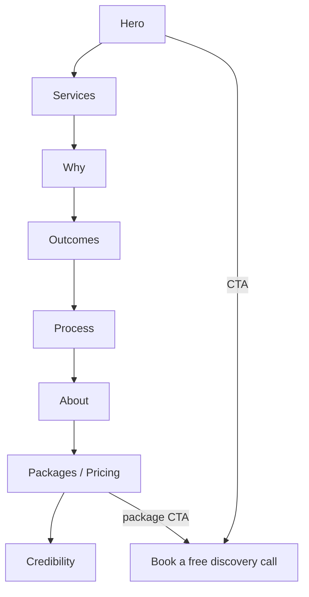

# Vibe Virtue — App Flow

## Structure
A single-page site: `RootLayout` → `HomePage` composed of sections (Header/nav, Hero, Services, Why, Outcomes, Process, About, Packages/Pricing, Credibility, footer). Navigation (`src/data/navigation.ts`) is in-page anchor links.

## Main journey
1. Land on the hero → read the value proposition.
2. Scroll/anchor through Services → Why/Outcomes → Process → About → Packages (pricing) → Credibility.
3. Click a CTA (e.g. "Book a free discovery call" / a package CTA) → booking/contact destination.

## Errors / empty states
- None meaningful (static content). Anchor links resolve to sections; the About anchor resolves (per commit history).

## Navigation map (mermaid)

## Open questions
- Where does the CTA go (scheduler, email, or a contact form)?

## Changelog

- **2026-10-18** — Initial reverse-documented draft from the codebase (executor documentation bot). Facts drawn from the repo/box source at the commit recorded in `/workspace/project-docs/state.json`.
