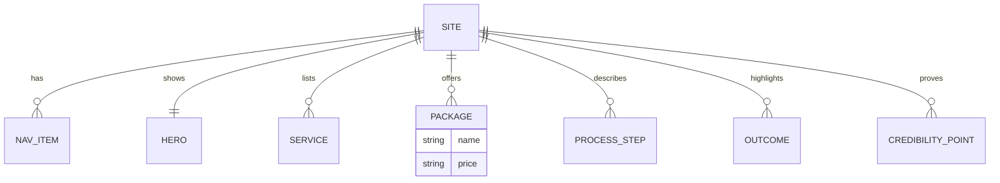

# Vibe Virtue — Backend Schema

## Datastore
None. Vibe Virtue is a static, content-driven marketing SPA with no backend and no database.

## Content "data model" (typed files in `src/data/`)
- `site.ts` — site/brand metadata. `navigation.ts` — nav items/anchors.
- `hero.ts` — hero copy. `services.ts` — six services. `outcomes.ts`, `process.ts`, `about.ts`, `credibility.ts` — section content.
- `packages.ts` — consultation packages with `name` + `price` (Free → $750/month, plus Custom quote).
- Types in `src/types/content.ts` and `src/types/ui.ts`.

## Browser storage / cookies
- None used by the site.

## "ER" diagram (content shape, mermaid)

## Endpoints / webhooks / jobs / retention
- None. The only outbound is the CTA link/form destination (to confirm). Nothing is stored server-side.

## Open questions
- If a contact form is added, define where submissions go (email/Formspree/etc.) and any anti-spam.

## Changelog

- **2026-10-18** — Initial reverse-documented draft from the codebase (executor documentation bot). Facts drawn from the repo/box source at the commit recorded in `/workspace/project-docs/state.json`.
